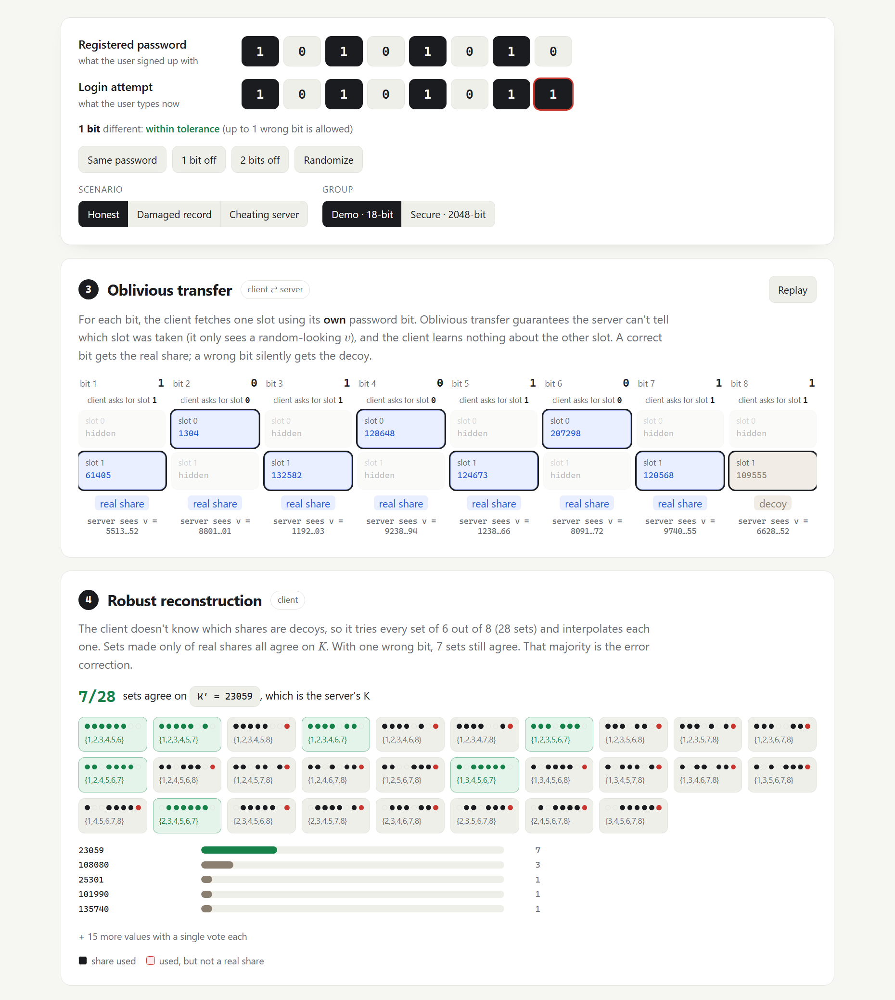
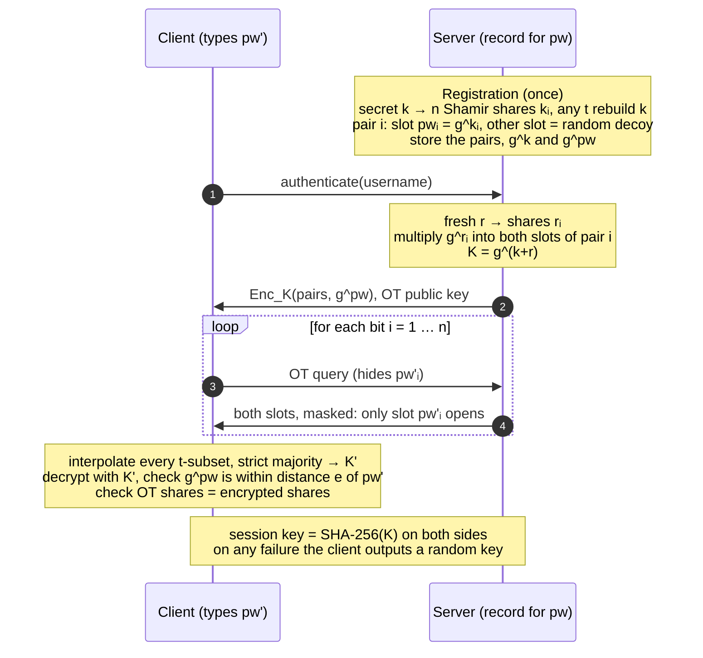
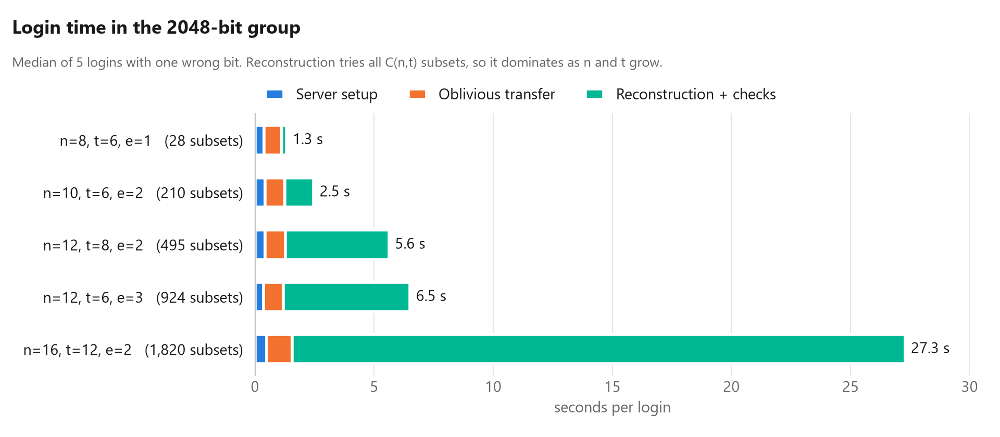

# PAKE: Fuzzy Asymmetric Password-Authenticated Key Exchange

[](https://github.com/CedricBohni/PAKE/actions/workflows/ci.yml)
[](https://cedricbohni.github.io/PAKE/)


[](LICENSE)

Log in with a password that is **almost right**. A client and a server agree on a shared key whenever the
typed password is within a set Hamming distance of the registered one (by default, one wrong bit). The
server never stores the password, and neither side learns which bits were wrong. A wrong password simply
produces a key that doesn't match.

This is a Python implementation of the fuzzy aPAKE construction from
[Erwig, Hesse, Orlt and Riahi, *Fuzzy Asymmetric Password-Authenticated Key Exchange*](https://eprint.iacr.org/2020/987),
built on robust secret sharing in the exponent and 1-out-of-2 oblivious transfer.

**[▶ Open the interactive walkthrough](https://cedricbohni.github.io/PAKE/)**: flip password bits, damage
the server's record or let the server cheat, and watch every step of a login. Every number is computed
live by this package, running in your browser.

<picture>
  <source media="(prefers-color-scheme: dark)" srcset="docs/visualizer-dark.png">
  
</picture>

**Highlights**

- **The full protocol, in pieces you can inspect.** Shamir sharing with error correction in the exponent, RSA-based
  oblivious transfer, AES-GCM, and a networking layer that never touches the cryptography. The protocol
  is plain Python objects ([`protocol.py`](src/fapake/protocol.py)), so the TCP demo, the tests and the
  browser walkthrough all run the same code.
- **Real parameters by default.** The RFC 3526 2048-bit group, a fresh 3072-bit RSA key per server
  start, randomness from `secrets`, and 256-bit session keys. A login takes about 1.3 s. A tiny demo group
  (`--demo`) keeps the numbers readable for teaching.
- **About 5× faster than the straightforward implementation.** Reconstruction scales the Lagrange coefficients
  to small integers so that each of the 28 subsets costs only small exponentiations, and the RSA step uses the
  CRT. Together this brought a login from 6.5 s to about 1.3 s.
- **Tested against attacks, not just happy paths.** 135 tests, including damaged records, a server that
  cheats during the transfer, invalid shares that try to win the vote, malformed network input, and concurrent
  sessions. CI runs them on Linux and Windows with Python 3.11, 3.13 and 3.15.

## How it works



A correct bit fetches a real share, a wrong bit silently fetches the decoy. Robust reconstruction tolerates
up to *e* decoys among the *n* shares, which is exactly what makes the protocol fuzzy.

| Step | Who | Operation |
|---|---|---|
| Register | server | *k* ←$ ℤ_q, Shamir shares *k*₁ … *kₙ* (degree *t*−1). Pair *i* holds *g^kᵢ* in slot *pwᵢ* and *g^ρᵢ* (random) in the other. |
| Mask | server | *r* ←$ ℤ_q with shares *rᵢ*. Both slots of pair *i* are multiplied by *g^rᵢ*, so the real shares now share *K* = *g*^(*k*+*r*). |
| Transfer | both | One 1-out-of-2 RSA oblivious transfer per bit. The server can't tell which slot was taken. |
| Reconstruct | client | Lagrange interpolation in the exponent over all C(*n*, *t*) subsets. A strict majority yields *K*′. |
| Verify | client | AES-GCM decryption with *K*′. Check that *g^pw* ∈ {*g^x* : d(*x*, *pw*′) ≤ *e*} and that the OT shares equal the encrypted ones. |
| Key | both | SHA-256(*K*), domain-separated from the AES key. |

The defaults are *n* = 8, *t* = 6, *e* = 1 (8-bit passwords, one wrong bit tolerated). Any parameters with
*t* + 2*e* ≤ *n* work, for example `Params(n=12, t=6, e=3)`.

## Performance

<picture>
  <source media="(prefers-color-scheme: dark)" srcset="docs/benchmark-dark.png">
  
</picture>

| Group | n | t | e | Subsets C(n,t) | Register (ms) | Server (ms) | OT (ms) | Reconstruct + checks (ms) | Login total (ms) |
|---|--:|--:|--:|--:|--:|--:|--:|--:|--:|
| 2048-bit | 8 | 6 | 1 | 28 | 1,053 | 373 | 745 | 211 | **1,329** |
| 2048-bit | 10 | 6 | 2 | 210 | 1,390 | 426 | 837 | 1,202 | **2,464** |
| 2048-bit | 12 | 8 | 2 | 495 | 988 | 420 | 856 | 4,350 | **5,627** |
| 2048-bit | 12 | 6 | 3 | 924 | 1,032 | 368 | 813 | 5,327 | **6,508** |
| 2048-bit | 16 | 12 | 2 | 1,820 | 897 | 487 | 1,064 | 25,734 | **27,285** |
| demo 18-bit | 8 | 6 | 1 | 28 | <1 | <1 | 32 | <1 | **33** |

Median of 5 logins with one wrong bit, Windows AMD64, Python 3.15. Raw data in
[docs/benchmark.json](docs/benchmark.json). To regenerate the table and the chart:

```bash
uv run python scripts/benchmark.py
uv run python scripts/plot_benchmark.py
```

**What the numbers show**

- With the default parameters, the oblivious transfers cost the most: 16 RSA private-key operations on a
  3072-bit modulus.
- Reconstruction tries every subset of *t* shares, so its cost follows C(*n*, *t*), not *n*. Going from 8
  to 16 bits multiplies the subsets by 65 and the login time by 20. Real deployments with long passwords
  would need a decoder such as Berlekamp–Welch in the exponent instead of brute force.
- The demo group is about 40× faster, almost all of it in RSA key operations. It exists to make the values
  readable, not to be fast.

## Quick start

This project uses [uv](https://docs.astral.sh/uv/). It supports Python 3.11 and newer; uv downloads a
suitable interpreter automatically.

```bash
git clone https://github.com/CedricBohni/PAKE.git
cd PAKE
uv sync
uv run pytest
```

`uv run pytest` runs the tests, which takes about 10 s. Add `-m "not slow"` to skip the ones that use
the 2048-bit group.

<details>
<summary>Installing uv</summary>

```powershell
# Windows (PowerShell)
powershell -ExecutionPolicy ByPass -c "irm https://astral.sh/uv/install.ps1 | iex"
```

```bash
# macOS / Linux
curl -LsSf https://astral.sh/uv/install.sh | sh
```

Open a new terminal afterwards so the `uv` command is found.
</details>

<details>
<summary>Without uv (pip)</summary>

```bash
python -m venv .venv
.venv\Scripts\activate        # Windows; on Linux/macOS: source .venv/bin/activate
pip install -e .
```

Then drop the `uv run` prefix from the commands below.
</details>

**Troubleshooting:** if uv fails with `invalid peer certificate: UnknownIssuer`, which is common behind
antivirus software or corporate proxies, add `--system-certs` (e.g. `uv sync --system-certs`) or set
`UV_SYSTEM_CERTS=1` permanently.

## Client–server demo

Run the two parts in separate terminals:

```bash
uv run fapake-server      # generates its RSA key, then listens on 127.0.0.1:65432
uv run fapake-client
```

1. Choose `1` to register, for example as `alice` with the password `10101010`.
2. Choose `2` to log in with the same password. Client and server print the same `SESSION KEY`.
3. Log in with one bit changed, such as `10101011`. The keys still match.
4. Log in with two bits changed, such as `10101111`. The client reports why it failed and its key differs.

| Command | Option | Default | Meaning |
|---|---|---|---|
| both | `--host` | `127.0.0.1` | Address to listen on / connect to |
| both | `--port` | `65432` | TCP port (use the same on both sides) |
| both | `--demo` | off | Use the 18-bit toy group, so stored values are readable (must match on both sides) |
| `fapake-server` | `--store` | `userFiles` | Folder where user records are saved |

<details>
<summary>Example session</summary>

```text
Choose an action:
1. Register
2. Authenticate
any: Exit
Enter your choice: 2
=== User Authentication ===
Enter username: alice
Enter 8-bit password: 10101011
SESSION KEY: 81b909a840c83c5c844f1af6babdf8a875392e957678fbf5ea078c8e1a755fa0
Time taken for authentication: 0.710440 seconds
```

The server's terminal shows `SESSION KEY (alice): 81b909a8…`, the same key.
</details>

Messages are length-prefixed JSON ([`wire.py`](src/fapake/wire.py)). Each connection gets its own thread
and its own authentication session, so several clients can log in at once.

## Interactive walkthrough

[`web/`](web/) is a static page that loads the Python package into [Pyodide](https://pyodide.org) inside a
Web Worker and visualizes one login in five stages: registration, the per-login mask, the eight oblivious
transfers, the subset vote, and the final checks with both session keys. Run it locally with

```bash
uv run python web/serve.py      # then open http://localhost:8000
```

The first load downloads the Python runtime (about 10 s). After that, each change recomputes in about 0.2 s
in the demo group. The [visualizer workflow](.github/workflows/pages.yml) publishes the page to GitHub Pages
on every push to `master`.

The same trace is available as JSON from the command line:

```bash
uv run python -m fapake.trace 10101010 10101011
```

## Repository layout

```text
├── src/fapake/
│   ├── protocol.py      # registration, server and client sessions (no networking)
│   ├── rss.py           # robust secret sharing in the exponent, subset voting
│   ├── ot.py            # RSA 1-out-of-2 oblivious transfer, key generation with CRT
│   ├── ic.py            # AES-GCM keyed by a group element
│   ├── modmath.py       # groups (RFC 3526 2048-bit, demo) and modular arithmetic
│   ├── wire.py          # length-prefixed JSON framing
│   ├── server.py        # threaded TCP server, user store
│   ├── client.py        # interactive TCP client
│   └── trace.py         # records every intermediate value of one run
├── web/                 # interactive walkthrough (HTML/CSS/JS + Pyodide worker, dev server)
├── tests/               # pytest suite (135 tests)
├── scripts/             # benchmark and chart generation
├── docs/                # generated benchmark table, chart and screenshots
└── development/         # earlier experiments (Berlekamp–Welch, brute force)
```

## Development

```bash
uv run pytest                  # tests
uv run ruff check .            # lint
uv run ruff format .           # format
```

CI ([.github/workflows/ci.yml](.github/workflows/ci.yml)) runs lint and the tests on every push and pull
request. The tests cover the group parameters, secret sharing and error correction, oblivious transfer,
message framing, the full protocol (exact, one-bit-off and two-bit-off passwords, damaged records, a cheating
server, mismatched groups), the trace used by the walkthrough, and real TCP sessions with concurrent
clients.

## Security notes and limitations

This is a research implementation that makes the construction concrete and inspectable. It has not been
audited. Don't use it to protect real accounts.

- **8-bit passwords have only 256 values.** Anyone holding a server record, or a transcript of a
  successful login, can try them all. Longer passwords need larger *n*, and then reconstruction cost grows
  with C(*n*, *t*) (see [Performance](#performance)).
- **Registration sends the password to the server in the clear,** and the TCP connection itself is not
  encrypted. Run it on a trusted network or behind TLS.
- **Not constant-time.** Python's big-integer arithmetic leaks timing.
- **The demo group (`--demo`) is deliberately insecure,** so that its values fit on screen.

## References

- A. Erwig, J. Hesse, M. Orlt, S. Riahi. *Fuzzy Asymmetric Password-Authenticated Key Exchange.*
  [IACR ePrint 2020/987](https://eprint.iacr.org/2020/987).
- T. Kivinen, M. Kojo. *More Modular Exponential (MODP) Diffie-Hellman groups for IKE.*
  [RFC 3526](https://www.rfc-editor.org/rfc/rfc3526) (the 2048-bit group).
- S. Even, O. Goldreich, A. Lempel. *A Randomized Protocol for Signing Contracts.* CACM 1985 (the RSA-based
  oblivious transfer).

## Author

**Cedric Bohni**

## License

[MIT](LICENSE)
